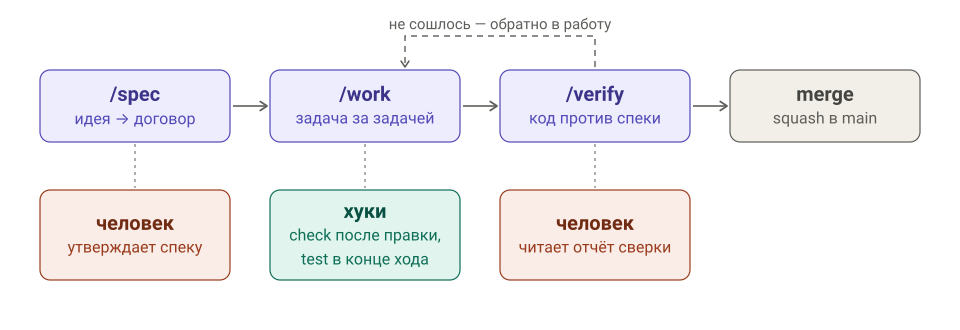

# agent-kit

Плагин Claude Code для проектов, которые разрабатываются вместе с ИИ.
Одна фраза: спека это договор, команды двигают проект по договору,
хуки держат код зелёным.

Вы пишете идею и утверждаете спеку. Агент пишет тесты и код задача за
задачей. Вместо диффов вы читаете два документа: спеку и отчёт сверки.

## Цикл

<picture>
  <source media="(prefers-color-scheme: dark)" srcset="docs/cycle-dark.svg">
  
</picture>

Человек нужен в двух точках: утвердить спеку и прочитать отчёт
сверки. Всё между ними делает агент, а хуки держат его в рамках:
каждая правка проходит `check`, каждый ход заканчивается `test`.

## Команды

Вызываются с префиксом `/agent-kit:`, ниже без него.

| Команда | Что делает |
|---|---|
| `/init [путь] [--local]` | Подключить проект: контракт `scripts/*`, CLAUDE.md, CI, первый коммит. `--local` для чужого проекта, см. ниже |
| `/spec <идея>` | Идея → спека в `docs/specs/` с критериями приёмки и задачами, ветка `spec/NNN-slug` |
| `/spec NNN: <что изменить>` | Дельта к спеке: номера критериев не сдвигаются, `done` → `approved` |
| `/work [NNN \| NNN.K]` | Задача из спеки: падающие тесты → код → зелёные проверки → коммит `[SPEC-NNN.K]` |
| `/verify [NNN]` | По каждому критерию: тест, код, не найден, противоречит. Зелёная сверка → `done` и squash |
| `/sync [путь]` | Обновить скрипты контракта до текущих шаблонов плагина, локальные правки переносятся |

## Что получает проект

После `/init`:

```
scripts/check [файлы]      типы и линт; с файлами — быстро, по ним зовёт хук
scripts/test               все тесты; пустой набор — не провал
scripts/fix [файлы]        автоформат, молча
CLAUDE.md                  стек, контракт, процесс, git-конвенции
docs/specs/                спеки, по файлу на фичу
docs/backlog.md            идеи и найденное по пути, а не правки «заодно»
.github/workflows/ci.yml   те же check и test на сервере
```

Три скрипта — единственная связь плагина со стеком. Хуки и CI зовут
только их и не знают, что внутри.

## Спека и отчёты

Спека — один файл на фичу, статус `draft → approved → done`:

```markdown
---
status: approved
covers: [src/export.ts, src/cli.ts]
---
# SPEC-005: Экспорт в CSV

## Зачем
Пользователи просят выгрузку, чтобы считать в таблицах.

## Что делаем
Команда `export` пишет все записи в CSV с заголовком.

## Границы
Фильтры и выбор колонок — отдельная спека.

## Критерии приёмки
- AC-1: файл начинается со строки заголовка
- AC-2: запятая и кавычки в значениях экранируются по RFC 4180
- AC-3: пустая база даёт файл из одной строки заголовка

## Подход
Свой сериализатор, библиотека ради трёх правил не нужна.

## Задачи
- [x] 1. Сериализатор строк (AC-1, AC-2)
- [ ] 2. Команда export (AC-3), после 1
```

Каждый критерий закрывается ровно одной задачей, и из каждого пишется
тест с маркером `SPEC-005 AC-2: ...`. По маркеру `/verify` находит, чем
критерий подтверждён, и отвечает таблицей:

| Критерий | Статус | Где |
|---|---|---|
| AC-1 | тест | tests/export.test.ts:12 |
| AC-2 | тест | tests/export.test.ts:20 |
| AC-3 | противоречит | src/cli.ts:41 — при пустой базе файл не создаётся |

Спека всегда права: расхождение чинится в коде, спека меняется только
через `/spec NNN: ...`. Отчёт `/work` после каждой задачи — четыре
строки: сделано, критерии, в backlog, нужно решение.

## Хуки

| Хук | Момент | Что делает |
|---|---|---|
| post-edit-check | после Edit/Write | `scripts/check <файл>`; ошибка возвращается агенту |
| stop-test | агент завершает ход | `scripts/test`, если есть изменения; зелёный прогон кэшируется по диффу |
| guard | перед Bash | запрещает `--no-verify` и force push в main/master |
| prompt-timestamp, notification | ход и ожидание | уведомления «ждёт ответа» и «задача завершена» после долгого хода |

Хуки — короткая петля обратной связи, а не защита от агента. Без
`scripts/check` и `scripts/test` в проекте они молчат. stop-test видит
проект в корне сессии: открывайте сессию в папке проекта.

## Стеки

| Стек | check | test | Нужно на машине |
|---|---|---|---|
| `node` | tsc + oxlint или eslint | vitest или jest | node |
| `astro` | astro check + линтер, если есть | сборка сайта + vitest, если есть | node |
| `python` | ruff + mypy | pytest | uv |
| `swift-ios` | swift format + сборка SPM-пакетов | swift test + smoke xcodebuild | Xcode 16, xcodegen |
| `monorepo` | диспетчер по пакетам | диспетчер по пакетам | по стекам пакетов |

Инструменты определяются по `package.json`, своему или родительскому.
Другой стек: скрипты пишутся по образцу ближайшего с маркером
`# agent-kit/<стек>` в первой строке комментария, по нему работает
`/sync`.

## Чужой проект

`/init --local` для репозитория, где процесс уже есть: те же файлы, но
ни один tracked-файл не меняется, пути уходят в `.git/info/exclude`,
`CLAUDE.local.md` вместо `CLAUDE.md`. Правила проекта побеждают: ветка и
формат коммита его, спека остаётся вне git, `/verify` вместо squash
выдаёт текст PR из спеки. Сессию открывайте в папке проекта, иначе
`CLAUDE.local.md` не попадёт в контекст.

## Установка

```
claude plugin marketplace add just3is-dev/agent-kit
claude plugin install agent-kit@agent-kit
```

Работает и в десктопном приложении, где диалога `/plugin` нет. Плагин
копируется в кэш и сам не обновляется: после `git pull` или правок

```
claude plugin update agent-kit@agent-kit
```

и новая сессия. `/sync` обновляет скрипты в проектах, не сам плагин.

Декларативно, на уровне проекта, через `.claude/settings.local.json`
(в git не попадает; проверено для локального клона):

```json
{
  "extraKnownMarketplaces": {
    "agent-kit": { "source": { "source": "directory", "path": "/путь/к/agent-kit" } }
  },
  "enabledPlugins": { "agent-kit@agent-kit": true }
}
```

Для GitHub источник `{ "source": "github", "repo": "just3is-dev/agent-kit" }`,
не проверялся.

## Принципы

1. Контракт `check | test | fix` — единственная связь со стеком.
2. Спека — источник истины. Разошлись спека и код — чинится код.
3. Хуки — петля обратной связи, не клетка.
4. Содержание в markdown, механика тонкая. Команда не длиннее 80 строк.
5. GitHub необязателен. Новый гейт — только после реального дефекта,
   который он поймал бы.

История решений и этапы — [docs/plan.md](docs/plan.md), заметки обкаток —
`docs/trial-*.md`.

## Разработка кита

```
./scripts/check
./scripts/test
```

Коммиты в main, без обязательных PR. Скиллы `tdd` и `adr` лежат в
`skills/`, тексты команд в `commands/`, шаблоны стеков в `templates/`.
